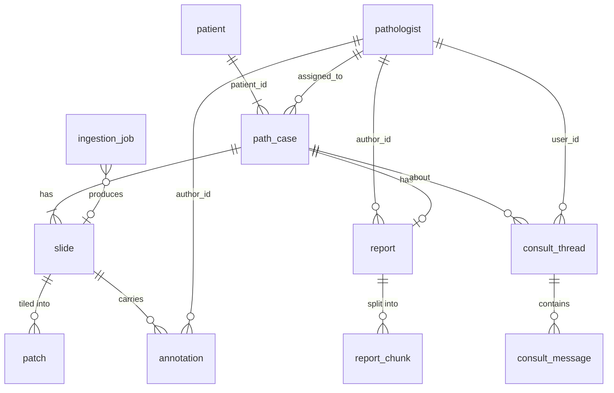

# Models

This folder documents the models of the application: the entities that are stored and the shapes the API returns. They are generated from the [features](../features/index.md). A field exists because a feature rule reads or writes it.

The store is Postgres with pgvector ([architecture D4](../architecture.md#decisions)). These docs are the specification for `python/sql/migrations/` and for the Pydantic models.

## Register

| Model | Table | Written by | Purpose | Used by |
| --- | --- | --- | --- | --- |
| [pathologist](pathologist.md) | `pathologist` | pipeline (seed) | The synthetic roster of report authors and app users. | F-01, F-04, F-07, F-08 |
| [patient](patient.md) | `patient` | pipeline | One de-identified patient across one or more cases over time. | F-01, F-02, F-05, F-07, F-09, F-12 |
| [case](case.md) | `path_case` | pipeline | One specimen submission for one patient. | F-01, F-02, F-05, F-07, F-12 |
| [slide](slide.md) | `slide` | pipeline | One whole slide image of a case. | F-03, F-05, F-06 |
| [patch](patch.md) | `patch` | pipeline | One tile of tissue with its embedding. | F-03, F-05, F-06 |
| [report](report.md) | `report` | pipeline | The pathology report of a case. | F-02, F-04, F-05, F-07 |
| [report_chunk](report_chunk.md) | `report_chunk` | pipeline | A passage of a report with its embedding. | F-02, F-05, F-07 |
| [concept](concept.md) | `concept` | pipeline (seed) | A curated phrase for heatmaps. | F-06 |
| [annotation](annotation.md) | `annotation` | app | A marked region on a slide. | F-08 |
| [consult_thread](consult_thread.md) | `consult_thread` | app | A conversation with the agent about a case. | F-07 |
| [consult_message](consult_message.md) | `consult_message` | app | One turn in a thread, with citations. | F-07 |
| [ingestion_job](ingestion_job.md) | `ingestion_job` | app, worker | A queued single-slide ingestion. | F-09 |
| [search_hit](search_hit.md) | — (not stored) | — | The result shapes search returns. | F-02, F-05, F-07 |

## Relationships



## Embedding spaces

| Space | Dimension | Type | Model | Columns |
| --- | --- | --- | --- | --- |
| `conchz` | 768 | `halfvec(768)` | CONCH-Z image-text space, L2-normalised | `patch.embedding`, `slide.embedding`, `concept.embedding`, `concept.negative_embedding` |
| `report` | 384 | `vector(384)` | BAAI/bge-small-en-v1.5, L2-normalised | `report_chunk.embedding` |

A query vector is only ever compared with columns of its own space. All comparisons use cosine distance.

## Conventions

- Table and column names are snake_case; tables are singular. The case table is `path_case` because `case` is a reserved word in SQL; everywhere else it is called a case, and foreign keys are `case_id`.
- Entities loaded from TCGA have readable text primary keys built from their source. Entities created in the app have `uuid` keys.
- Every table has `created_at timestamptz not null default now()`.
- Enumerations are `text` with a `check` constraint listing the allowed values.
- Coordinates are integers in level-0 pixels of the slide's original file.
- `in_corpus` on `patch` and `report_chunk` is true only for signed-out, non-held-out cases. Search filters on it; this is how held-out and open cases stay out of results.
- Pipeline-written tables have a parquet export and a Delta gold table of the same name. App-written tables exist only in Postgres.

## Template

File name: the model name, `snake_case.md`. Copy this exactly.

```markdown
---
model: model_name
table: table_name          # or "none" for an API-only shape
status: planned            # planned | in-progress | done | cut
written_by: pipeline       # pipeline | app | worker | none
used_by: [F-NN]
---

# model_name

## Purpose
One or two sentences: what one row is.

## Fields

| Field | Type | Null | Description |
| --- | --- | --- | --- |

## Relationships
Bullets: foreign keys in and out.

## Indexes
Bullets: index, type, and the query it serves.

## Rules
Numbered invariants the data must satisfy.

## Source
Where the values come from: GDC or TCGA-Reports field, pipeline stage, or user action.

## API shape
The Pydantic model name(s), and which fields are omitted or added when sent to the client.
```

## Rules for model docs

- Types are Postgres types.
- Every field's description says what it means, and names the feature rule that needs it if that is not obvious.
- Anything synthetic is said to be synthetic under Source.
- A field that must never reach the client is named under API shape.
- Change the doc and the migration in the same pull request.
